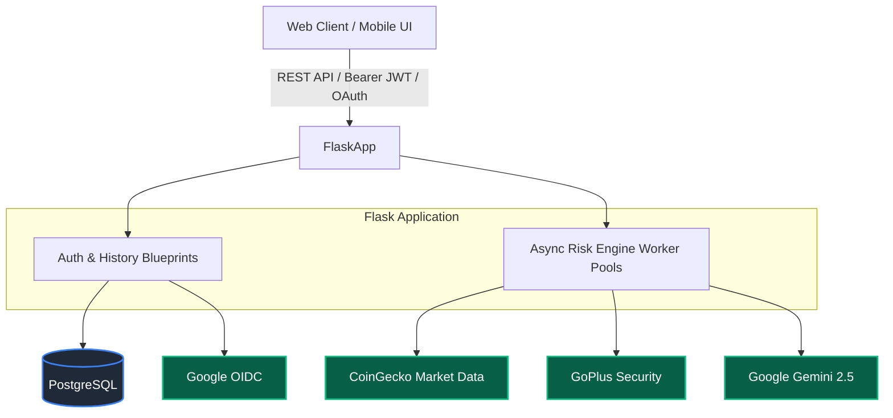

<<<<<<< HEAD
# 🛡️ CryptoRisk AI

> *An institutional-grade cryptocurrency intelligence and risk analysis platform powered by Flask, Google Gemini, and GoPlus.*

[](https://crypto-risk-ai-2.onrender.com)
[](https://www.python.org/)
[](https://flask.palletsprojects.com/)
[](LICENSE)
[](.github/workflows/ci.yml)

CryptoRisk AI synthesizes quantitative market metrics, smart contract security audits, historical drawdowns, and **Google Gemini** generative AI reasoning into a multi-pillar risk report for web3 assets.

---

## 🏗️ System Architecture



### Key Architectural Characteristics
- **Unified Service Architecture:** High-efficiency Flask backend serving both modular RESTful API endpoints and static SPA frontend.
- **Asynchronous Execution Pipeline:** Thread pool executors decouple compute-heavy multi-provider fetches from web request threads, returning immediate job IDs with polled progress updates.
- **Multi-Tier Fault Tolerance:** In-memory caching with graceful stale-snapshot fallbacks, automatic rate-limit cooldown management, and defensive parsing guarantees high uptime during external provider degraded states.
- **Strict Security & Authentication:** Passwords hashed with standard `bcrypt`, tamper-proof HS256 JWT sessions, Google OAuth 2.0 integration, and parameterized PostgreSQL queries via connection pooling.

---

## 🛠️ Technology Stack

| Layer | Technology |
| :--- | :--- |
| **Frontend** | Vanilla JavaScript (ES Modules), Custom Modern CSS3 (Dark Luxury Theme), HTML5 |
| **Backend** | Python 3.10+, Flask, Gunicorn (`gthread` async worker model) |
| **Database** | PostgreSQL with `psycopg2` Threaded Connection Pool & `pgcrypto` UUIDs |
| **Authentication** | JSON Web Tokens (`PyJWT`), Google OAuth 2.0 (`Authlib`), `bcrypt` |
| **Market Intelligence**| CoinGecko API (Demo / Pro) |
| **Contract Security**| GoPlus Token Security API (EVM Chain Analysis) |
| **Generative AI** | Google Gemini API (`gemini-2.5-flash`) |

---

## ⚡ Core Features

- **Multi-Pillar Risk Scoring:** Calculates composite risk index (0–100) combining Volatility, Liquidity, Market Sensitivity (Beta), and Smart Contract Integrity.
- **Contract Security Scanning:** Automatically analyzes EVM token contracts for honeypots, exorbitant buy/sell taxes, blacklisting capabilities, and ownership privileges via GoPlus.
- **Native Asset Awareness:** Automatically identifies Layer-1 native assets (BTC, ETH, SOL, AVAX, etc.) and adjusts audit criteria accordingly.
- **AI Executive Risk Synthesis:** Employs Google Gemini to analyze multi-source data and output structured executive summaries, risk regime assessments, and critical watch items.
- **Interactive Analysis History:** User analysis history is securely stored in PostgreSQL with collapsible inspection drawers and real-time live market updates.

---

## 📂 Project Structure

```text
Crypto-Risk-AI/
├── backend/                     # Server-side domain, APIs, and business logic
│   ├── app.py                   # Application factory & blueprint registration
│   ├── config.py                # Environment configuration & provider settings
│   ├── extensions.py            # DB connection pool, OAuth, and executor setup
│   ├── pre_start.py             # Pre-deployment database migrations & schema setup
│   ├── gunicorn.conf.py         # Production WSGI server configuration
│   ├── requirements.txt         # Pinned Python production dependencies
│   ├── routes/                  # Modular Flask blueprints (auth, risk, market, history)
│   ├── services/                # Quantitative risk engine, CoinGecko, GoPlus, Gemini AI
│   └── utils/                   # Telemetry helpers, mathematical statistics, error models
│
├── frontend/                    # Presentation layer and client application
│   ├── static/                  # Static frontend assets
│   │   ├── style.css            # Dark luxury design system & responsive layout
│   │   └── js/                  # ES modules (state store, API clients, UI components)
│   └── templates/               # Jinja2 templates
│       ├── index.html           # Landing & authentication page
│       └── dashboard.html       # Analytics dashboard & interactive terminal
│
├── tests/                       # Pytest test suites (Auth, Risk Engine)
├── docs/screenshots/            # UI screenshots for README
├── app.py                       # Root application entrypoint proxy
├── wsgi.py                      # Root WSGI server callable for Gunicorn
├── pre_start.py                 # Root pre-deployment migration bridge
├── gunicorn.conf.py             # Root Gunicorn server configuration
├── requirements.txt             # Root dependency pointer for Render builds
├── render.yaml                  # Render deployment configuration
└── .env.example                 # Configuration template
=======
# CryptoRisk AI — Institutional Crypto Risk & Intelligence Terminal

[](https://cryptorisk-ai.pages.dev)
[](https://cryptorisk-ai.pages.dev)
[](https://ai.google.dev)
[](https://gopluslabs.io)

> **Live Production Terminal:** [https://cryptorisk-ai.pages.dev](https://cryptorisk-ai.pages.dev)  
> Zero-downtime, serverless multi-pillar cryptocurrency risk scoring and AI intelligence engine deployed globally across 300+ edge locations.

---

## Executive Overview

**CryptoRisk AI** is an institutional-grade cryptocurrency intelligence terminal and automated quantitative risk engine. Built by veteran Web3 engineers, the platform synthesizes real-time order book liquidity, historical price volatility, benchmark market sensitivity ($\beta$), EVM bytecode smart contract security audits, and Google Gemini generative AI reasoning into a standardized, deterministic multi-pillar risk report ($0 - 100$ index).

The entire system is deployed on **Cloudflare Pages** utilizing an **Advanced Mode Edge Worker (`_worker.js`)**, eliminating cold starts, third-party hosting bottlenecks, and dyno sleep cycles.

```
                      ┌─────────────────────────────────────────────────────────────┐
                      │              Cloudflare Anycast Global Edge                 │
                      │               https://cryptorisk-ai.pages.dev               │
                      └──────────────────────────────┬──────────────────────────────┘
                                                     │
                         ┌───────────────────────────┴───────────────────────────┐
                         ▼                                                       ▼
      ┌─────────────────────────────────────┐                 ┌─────────────────────────────────────┐
      │     Static Asset Distribution       │                 │       Cloudflare Edge Worker        │
      │           (Edge CDN)                │                 │             (_worker.js)            │
      ├─────────────────────────────────────┤                 ├─────────────────────────────────────┤
      │ • Landing View (index.html)         │                 │ • Multi-Pillar Quant Risk Engine    │
      │ • Terminal SPA (dashboard.html)     │                 │ • WebCrypto JWT Authentication      │
      │ • Modular ES Scripts (static/js/*)  │                 │ • Async Job Pipeline & Polling      │
      │ • Dark Luxury CSS (static/style.css)│                 │ • Live Market Telemetry In-Memory   │
      └─────────────────────────────────────┘                 └──────────────────┬──────────────────┘
                                                                                 │
                                     ┌───────────────────────────────────────────┼───────────────────────────────────────────┐
                                     ▼                                           ▼                                           ▼
                      ┌─────────────────────────────┐             ┌─────────────────────────────┐             ┌─────────────────────────────┐
                      │        CoinGecko API        │             │    GoPlus Security API      │             │    Google Gemini 2.5 AI     │
                      │   (Demo / Pro Market Data)  │             │   (EVM Smart Contract Audit)│             │ (Executive Risk Synthesis)  │
                      └─────────────────────────────┘             └─────────────────────────────┘             └─────────────────────────────┘
>>>>>>> fc5c1ec (feat: migrate deployment from Render to Cloudflare Pages & edge worker, clean repository architecture, and update documentation)
```

---

<<<<<<< HEAD
## 🚀 Getting Started
=======
## Core Pillars of Risk Scoring
>>>>>>> fc5c1ec (feat: migrate deployment from Render to Cloudflare Pages & edge worker, clean repository architecture, and update documentation)

The quantitative engine evaluates digital assets across four core risk dimensions, generating a standardized composite risk score from $0$ (lowest risk) to $100$ (critical risk):

### 1. Realized Volatility ($\omega_v = 0.30$)
Calculates the annualized sample standard deviation of continuous log-returns over a historical window:
$$\sigma_{\text{ann}} = \sqrt{365} \cdot \sqrt{\frac{1}{N-1} \sum_{i=1}^N \left( \ln\frac{P_i}{P_{i-1}} - \mu \right)^2}$$
- $\le 20\%$ annualized: **15 / 100** (Minimal Volatility)
- $\le 40\%$ annualized: **30 / 100** (Low Risk)
- $\le 60\%$ annualized: **50 / 100** (Moderate Risk)
- $\le 80\%$ annualized: **70 / 100** (Elevated Risk)
- $\le 120\%$ annualized: **85 / 100** (High Volatility)
- $> 120\%$ annualized: **95 / 100** (Extreme Tail Risk)

### 2. Secondary Market Liquidity ($\omega_l = 0.25$)
Evaluates trading velocity, order book depth, and 24-hour volume-to-market-cap turnover:
$$\text{Turnover Ratio} = \frac{\text{Volume}_{24\text{h}}}{\text{Market Cap}}$$
Penalizes illiquid micro-caps ($< \$1\text{M}$ volume) with immediate elevated risk classifications to protect portfolios from slippage and exit liquidity traps.

### 3. Market Sensitivity / Beta ($\omega_\beta = 0.20$)
Measures the directional covariance of asset returns relative to Bitcoin ($\text{BTC}$) as the market benchmark:
$$\beta = \frac{\text{Cov}(R_{\text{asset}}, R_{\text{BTC}})}{\text{Var}(R_{\text{BTC}})}$$
- $\beta < 0.8$: Low Market Beta (30)
- $0.8 \le \beta \le 1.3$: Moderate Market Sensitivity (48)
- $1.3 < \beta \le 1.8$: High Cyclical Beta (68)
- $\beta > 1.8$: Extreme Volatility Magnifier (85)

### 4. Smart Contract Security ($\omega_s = 0.25$)
Integrates directly with GoPlus EVM bytecode telemetry:
- **Honeypot Detection:** Automatic $100 / 100$ Critical Risk on verified bytecode sell restrictions.
- **Trading Tax Analysis:** Flags buy/sell extraction fees exceeding $10\%$.
- **Privilege Vectors:** Audits blacklist capabilities, un-capped minting functions, and owner balance manipulation.
- **Layer-1 Native Assets:** Recognizes base Layer-1 assets (BTC, ETH, SOL, AVAX) and automatically marks contract attack surface as verified/NA.

### 5. Deterministic Stress Testing Engine
Every asset is subjected to simulated macro drawdowns:
1. **2020 Flash Crash (Black Thursday):** $-50\%$ systemic market liquidation.
2. **FTX Counterparty Insolvency:** $-28\%$ Tier-1 centralized exchange freeze.
3. **Terra / LUNA Depeg Contagion:** $-35\%$ decentralized liquidity run.
4. **Macro Yield Shock:** $+100\text{bps}$ interest rate surge rotation.

---

## Production Deployment: Cloudflare Pages

The project runs completely on **Cloudflare Pages** with an **Edge Worker gateway (`_worker.js`)**, providing:
- **Global Edge Execution:** Sub-10ms latency across 300+ data centers worldwide.
- **Unified Domain:** Frontend static SPA and RESTful APIs share the clean `pages.dev` origin.
- **Zero Cold Starts:** V8 isolates execute instantaneously with zero warm-up latency.
- **Zero Render Dependencies:** No reliance on sleeping dynos or fragile container hosts.

```bash
# Build production assets and bundle the Edge Worker
node build_cloudflare.js
node create_worker.js

# Deploy directly to Cloudflare Pages
wrangler pages deploy dist --project-name cryptorisk-ai --branch main
```

<<<<<<< HEAD
Edit `.env` and provide your credentials (reference the Environment Variables table below).
=======
---

## RESTful Edge API Reference

### System Health
```http
GET /health
GET /api/health
```
**Response (200 OK):**
```json
{
  "success": true,
  "status": "healthy",
  "service": "CryptoRisk AI",
  "version": "3.2.0",
  "runtime": "Cloudflare Pages Edge Runtime (V8 Worker)",
  "gemini_configured": true,
  "coingecko_key_configured": true,
  "market_data_provider": "CoinGecko"
}
```
>>>>>>> fc5c1ec (feat: migrate deployment from Render to Cloudflare Pages & edge worker, clean repository architecture, and update documentation)

### Market Telemetry
```http
GET /api/market/:symbol
```
Retrieves real-time price, 24h change, volume, high/low, and market cap with edge caching.

### Asynchronous Risk Pipeline
```http
POST /api/analyze/start
Content-Type: application/json

{
  "token_symbol": "ETH",
  "chain_id": "1",
  "contract_address": "0x..."
}
```
**Response (202 Accepted):**
```json
{
  "success": true,
  "job_id": "job_ETH_1793444336458_29a63dc8",
  "job": {
    "id": "job_ETH_1793444336458_29a63dc8",
    "token_symbol": "ETH",
    "status": "completed",
    "progress": 100
  }
}
```

### Job Status Polling
```http
GET /api/analyze/status/:jobId
```
Returns completed status, quantitative pillars, stress test matrices, and the bespoke Gemini AI narrative.

### Authentication & Sessions
- `POST /api/auth/signup`: Registers user with WebCrypto PBKDF2 hashing + HS256 JWT.
- `POST /api/auth/login`: Verifies credentials and returns access token.
- `GET /api/auth/me`: Validates `Authorization: Bearer <token>` and returns profile.
- `POST /api/auth/logout`: Graceful session termination.

### Dashboard & History
- `GET /api/dashboard`: Aggregates active user state, latest analysis, and history.
- `GET /api/history`: Retrieves saved reports.
- `DELETE /api/history/:id`: Removes single analysis report.

---

## Repository Structure

```
CryptoRisk-AI/
├── dist/                         # Compiled Cloudflare Pages distribution
│   ├── _worker.js                # Full-stack Cloudflare Edge Worker gateway
│   ├── _headers                  # Security & cache-control policies
│   ├── index.html                # Landing page SPA
│   ├── dashboard.html            # Intelligence terminal SPA
│   └── static/                   # Static CSS and ES modules
│       ├── style.css             # Dark luxury typography & responsive layout
│       └── js/                   # Vanilla ES modules (state, api, components)
│
├── backend/                      # Standalone Python Flask backend
│   ├── app.py                    # Application factory & blueprint gateway
│   ├── config.py                 # Provider keys & environment parameters
│   ├── extensions.py             # DB pool, OAuth, and thread executors
│   ├── requirements.txt          # Python production dependencies
│   ├── routes/                   # Modular Flask blueprints (auth, risk, market)
│   ├── services/                 # Risk engine, CoinGecko, GoPlus, Gemini AI
│   └── utils/                    # Math helpers, error models, telemetry
│
├── frontend/                     # Raw frontend source assets
│   ├── templates/                # Source HTML templates
│   └── static/                   # Source CSS and modular JavaScript
│
├── build_cloudflare.js           # Static asset compiler for Cloudflare Pages
├── create_worker.js              # Edge Worker compiler
├── app.py                        # Local development Python entrypoint
├── requirements.txt              # Root dependency manifest
└── .env.example                  # Environment configuration template
```

---

## Local Development

### 1. Python Local Backend
```bash
# Create virtual environment
python -m venv .venv
source .venv/bin/activate  # Or on Windows: .venv\Scripts\activate

<<<<<<< HEAD
pip install -r backend/requirements.txt
```
=======
# Install dependencies
pip install -r requirements.txt
>>>>>>> fc5c1ec (feat: migrate deployment from Render to Cloudflare Pages & edge worker, clean repository architecture, and update documentation)

# Run local development server
python app.py
```
Visit `http://localhost:5000`.

### 2. Cloudflare Pages Local Development
```bash
# Build static assets & edge worker
node build_cloudflare.js
node create_worker.js

<<<<<<< HEAD
---

## 🔒 Environment Variables Reference

| Variable | Description |
| :--- | :--- |
| `FLASK_ENV` | Environment (`development` or `production`) |
| `SECRET_KEY` | Secure random key for Flask sessions |
| `JWT_SECRET_KEY` | Secure key for signing JSON Web Tokens |
| `DATABASE_URL` | PostgreSQL connection string |
| `GEMINI_API_KEY` | Key for Google Gemini 2.5 API |
| `COINGECKO_API_KEY`| Key for CoinGecko |
| `COINGECKO_PLAN` | Plan tier (`demo` or `pro`) |
=======
# Test locally with Wrangler
wrangler pages dev dist
```
>>>>>>> fc5c1ec (feat: migrate deployment from Render to Cloudflare Pages & edge worker, clean repository architecture, and update documentation)

---

## 🌐 API Endpoint Reference

<<<<<<< HEAD
| Method | Endpoint | Description |
| :--- | :--- | :--- |
| `GET` | `/health` | System diagnostics and liveness probe |
| `POST` | `/api/auth/signup` | Register new user account |
| `POST` | `/api/auth/login` | Authenticate user |
| `GET` | `/api/auth/google` | Trigger Google OAuth 2.0 flow |
| `POST` | `/api/risk/analyze` | Submit an asset for risk analysis |
| `GET` | `/api/risk/job/<job_id>` | Poll analysis job status |
| `GET` | `/api/history` | Retrieve user's analysis history |

---

## 📊 Risk Methodology

The engine calculates risk based on several independent pillars:

1. **Market Risk:** Focuses on drawdowns (difference between ATH and current price) and volatility.
2. **Liquidity Risk:** Analyzes 24h trading volume against fully diluted valuation / market cap.
3. **Security Risk (GoPlus):** Static analysis of the contract (e.g. mintable flags, proxy logic, honeypot potential, buy/sell taxes).
4. **AI Synthesis:** Google Gemini correlates these structured data points against current market sentiment and macro regimes.

---

## 📸 Screenshots

*(Replace placeholders with actual UI screenshots from `docs/screenshots/`)*


*The main analytics dashboard showing multi-pillar risk scoring.*


*Async polling interface updating real-time job status.*

---

## 🧪 Testing and CI

This repository uses `pytest` for testing the risk engine logic, API routes, and authentication securely via mocked data.

To run tests:
```bash
pip install -e .[dev]
pytest tests/
```

We utilize GitHub Actions (`.github/workflows/ci.yml`) to enforce code formatting (`black`), linting (`ruff`), and testing on every pull request.

---

## 🗺️ Roadmap & Contributing

Please read the [CONTRIBUTING.md](CONTRIBUTING.md) and [SECURITY.md](SECURITY.md) guidelines before issuing a Pull Request.

**Future Items:**
- On-chain active liquidity pool analysis (Uniswap V3)
- Multi-chain deployment support for Solana and Avalanche
- Advanced charting for tokenomics vesting schedules

---

## ⚠️ Disclaimer

**Educational Tool, Not Financial Advice.** This platform is designed solely to aggregate and synthesize data. Cryptocurrencies are highly volatile and inherently risky. Use at your own risk.

---

**Author:** [chetanaybuilder](https://github.com/chetanaybuilder)
=======
Institutional Proprietary / MIT License. Designed for quantitative digital asset risk management.
>>>>>>> fc5c1ec (feat: migrate deployment from Render to Cloudflare Pages & edge worker, clean repository architecture, and update documentation)
